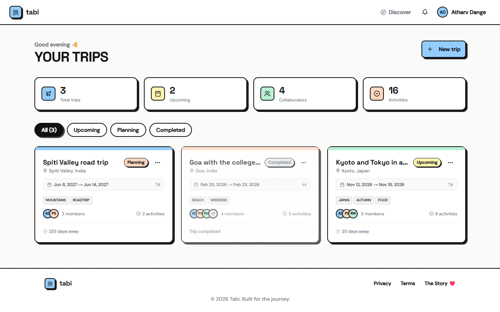
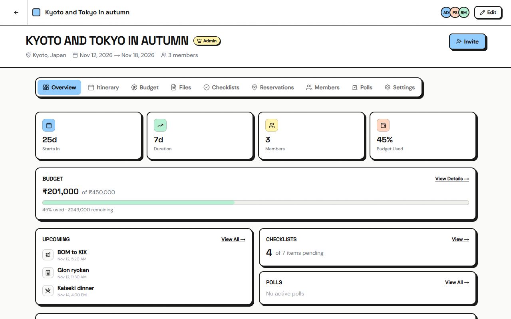
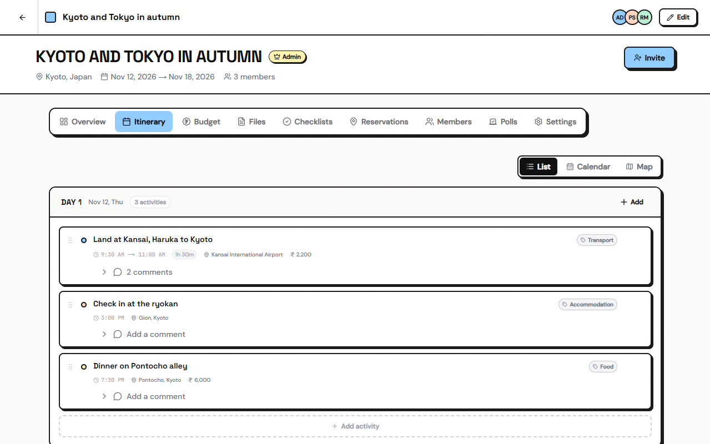
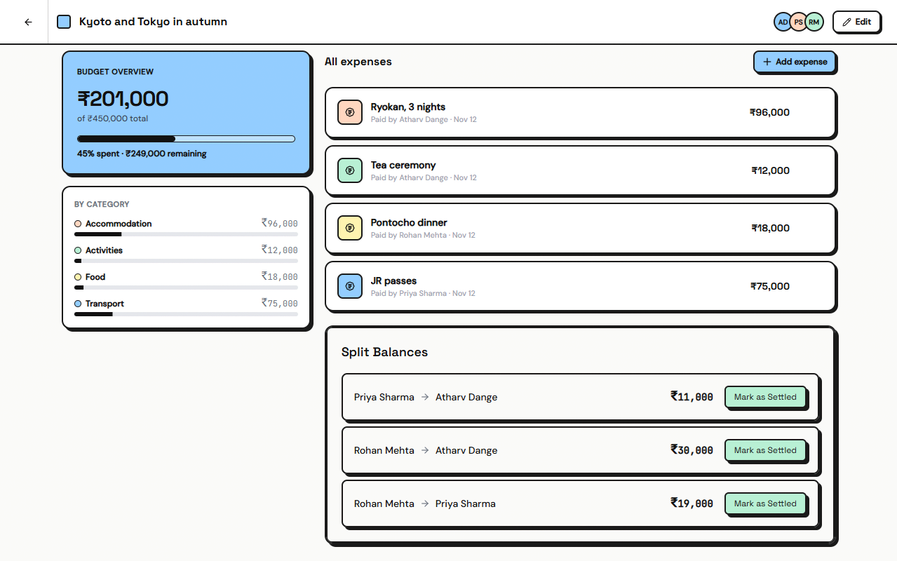
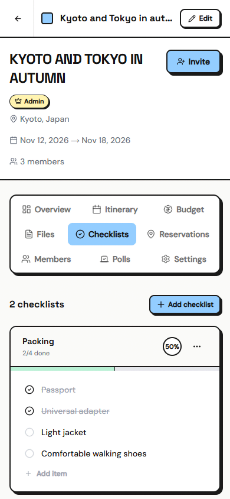

<div align="center">
  
  <h1>Tabi</h1>
  <p><strong>旅 · journey</strong></p>
  <p>Plan a group trip in one place instead of a group chat.</p>
  <p><a href="https://tabi.atharvdange.com">tabi.atharvdange.com</a></p>
</div>



## Why I care about this one

Tabi is the first thing I built that real people use. My friends and I plan our trips on it now.

It started from a problem we had ourselves, and that's what turned it from a project into a product. I wasn't building for a portfolio. I was building the thing we kept wishing we had every time a trip came up.

I didn't worry that Tabi lacked features. What mattered to me was taking a trip out of the group chat and putting all of it on one platform. If the plan, the money and the people live in one place, the trip already feels easier, and that was enough to ship.

## The problem

Every group trip I've been on went the same way. Someone makes a WhatsApp group with too many emojis in the name. One person builds a Google Sheet with five tabs that only they update. Flight links get buried under two hundred messages of "wait, who's booking?" After the trip, nobody knows who owes what, and the "hey, about the money" message sits in drafts for a week.

Tabi started at the ChaiCode Buildathon as my answer to that, and I kept building it after the event ended.

## What it does

### One plan everyone can see

Each trip gets a day for every date, and each day holds activities with a time, place, cost and notes. You can drag to reorder them, comment on them, and react with emoji. The server warns you when two activities overlap.



The itinerary was the hardest part to get right. It has three views: a list, a calendar and a map. Three views is easy to build and easy to get wrong, so I kept changing them until each one answered a question the others couldn't. The list is for editing. The calendar shows how full each day is. The map shows whether a day makes sense on foot.



### Money that settles itself

Log an expense and say who paid. Tabi tracks spending against the budget, breaks it down by category, and works out who owes whom. Then you mark a debt as settled when it's paid back, with no awkward voice note needed.



### Everything else a trip needs

- **Checklists** for packing and pre-trip tasks, with progress per list
- **Reservations** for flights, hotels and restaurants, with their reference numbers
- **Files** like tickets and booking screenshots, stored on Cloudinary
- **Polls** for the decisions a group can't make in chat
- **Notifications** when someone adds an expense, comments or changes the plan
- **Public trips** you can share as a read-only page, and a **Discover** page to browse other people's public trips

It works on a phone too, which matters when you're the one standing at the airport.

<p align="center">
  
</p>

### The right people can change the right things

Every trip member is an owner, an editor or a viewer. The server checks the role on every request, so hiding a button in the UI is never the only thing standing between a viewer and your itinerary.

| Action                                                     | Owner | Editor | Viewer |
| ---------------------------------------------------------- | :---: | :----: | :----: |
| View the trip and comment                                  |  ✅   |   ✅   |   ✅   |
| Edit activities, checklists, reservations, files, expenses |  ✅   |   ✅   |   ❌   |
| Edit trip details                                          |  ✅   |   ❌   |   ❌   |
| Invite members                                             |  ✅   |   ❌   |   ❌   |
| Transfer ownership                                         |  ✅   |   ❌   |   ❌   |
| Delete the trip                                            |  ✅   |   ❌   |   ❌   |

Ownership transfer is a request, not a switch. The person receiving it has to accept.

## How it's built

```
Next.js 16 client  ──REST + Clerk JWT──▶  Express 5 API  ──Mongoose──▶  MongoDB
  TanStack Query                            Clerk middleware
  Zustand                                   role guards
  React Hook Form                           Zod validation
         └──────────── shared/ Zod schemas ────────────┘
```

The client and the API are separate apps in one pnpm workspace, with a `shared/` package between them. In production both run on one Hostinger machine under one domain. The browser only ever calls `/api` on that domain, and a Next.js rewrite forwards it to the server on the same machine. Clerk handles sign-in, Cloudinary stores files, and Resend sends invite emails.

The two hardest problems in the codebase:

**Permissions.** I built the middleware chain before I built any feature: `requireAuth` → `resolveDbUser` → `requireMembership` → `requireRole`. It felt slow at the time. It paid off, because every feature after that got access control in two lines.

**Invites.** Inviting someone who already has an account is easy. Inviting someone who doesn't is not. Existing users get a pending membership. New emails get a separate pending invite with a token that expires in seven days, so the users collection never fills up with placeholder accounts for people who never sign up. It took two attempts to land on that split.

One rule held across the whole project: the client and server validate with the same Zod schemas from `shared/`, so changing a schema changes both sides at once.

More detail lives in [`docs/`](docs/).

## Run it locally

You need Node.js 24, pnpm (`corepack enable` picks up the pinned version), Docker, and free accounts on [Clerk](https://clerk.com) and [Cloudinary](https://cloudinary.com).

```bash
git clone https://github.com/atharvdange618/Tabi.git
cd Tabi
pnpm install
```

Create `server/.env` from `server/.env.example`. `RESEND_API_KEY` is optional. Without it, the server logs invite emails instead of sending them.

Create `client/.env.local`:

```env
NEXT_PUBLIC_CLERK_PUBLISHABLE_KEY=your_clerk_publishable_key
CLERK_SECRET_KEY=your_clerk_secret_key
NEXT_PUBLIC_CLERK_SIGN_IN_URL=/sign-in
NEXT_PUBLIC_CLERK_SIGN_UP_URL=/sign-up
NEXT_PUBLIC_CLERK_AFTER_SIGN_IN_URL=/dashboard
NEXT_PUBLIC_CLERK_AFTER_SIGN_UP_URL=/dashboard
NEXT_PUBLIC_APP_URL=http://localhost:3000
API_URL=http://localhost:8000
```

Then start MongoDB, the API and the client together:

```bash
docker compose up --watch
```

The app runs at `http://localhost:3000` and the API at `http://localhost:8000`. Compose runs MongoDB as a single-node replica set, because the server uses transactions, so you don't need Atlas. Edits sync into the containers. Compose reads the env files only when it creates a container, so after changing one, run `docker compose up -d --force-recreate`.

### Sync users from Clerk

In the Clerk dashboard, add a webhook pointing at `/api/v1/webhooks/clerk` on your API, subscribed to `user.created` and `user.updated`. Put its signing secret in `server/.env` as `CLERK_WEBHOOK_SECRET`. Trips and invites need these user records. For local development, expose port 8000 with a tunnel such as ngrok so Clerk can reach it.

### Fill it with sample trips

Sign in once so your user exists, then seed three trips with members, expenses and checklists:

```bash
MONGODB_URI="mongodb://127.0.0.1:27017/tabi?directConnection=true" pnpm --filter server seed you@example.com
```

Running it again replaces the seeded trips and leaves everything else alone.

### Without Docker

Point `MONGODB_URI` in `server/.env` at an Atlas replica set, then run `pnpm dev` in `server/` and in `client/`.

### Checks

```bash
pnpm --filter server test    # needs MONGOMS_VERSION=8.2.6 on Windows
pnpm --filter client test
pnpm --filter client lint
```

## License

MIT. See [LICENSE](LICENSE).

<div align="center">
  <p>Built by <a href="https://x.com/atharvdangedev">Atharv Dange</a>, for the trips my friends and I keep planning.</p>
</div>
